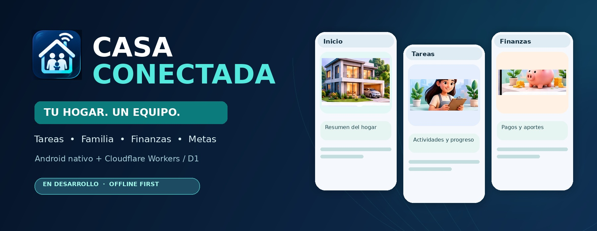
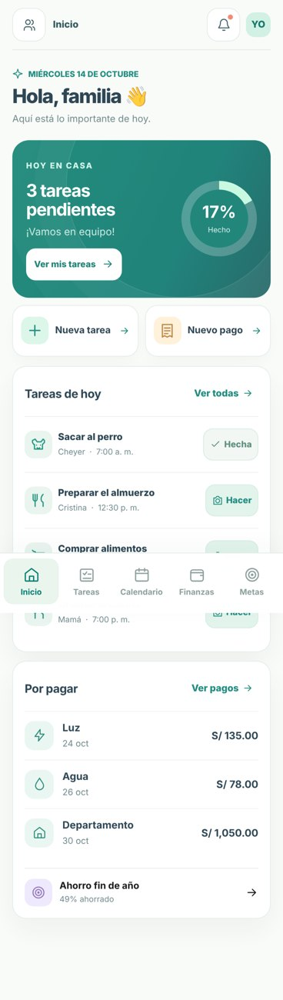
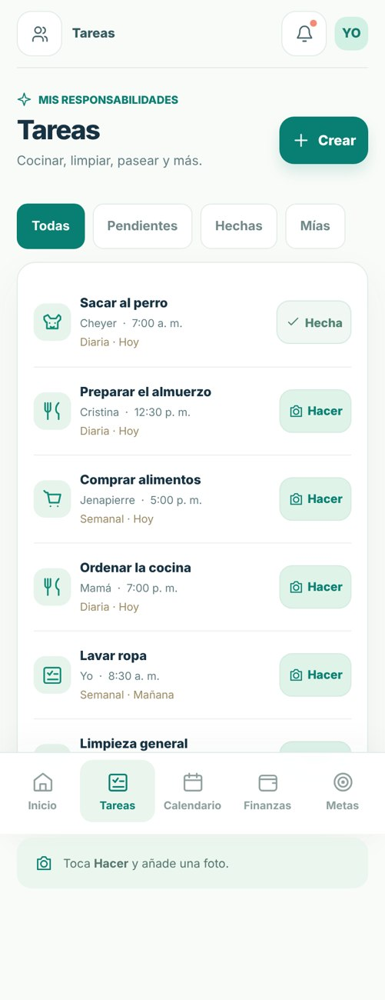
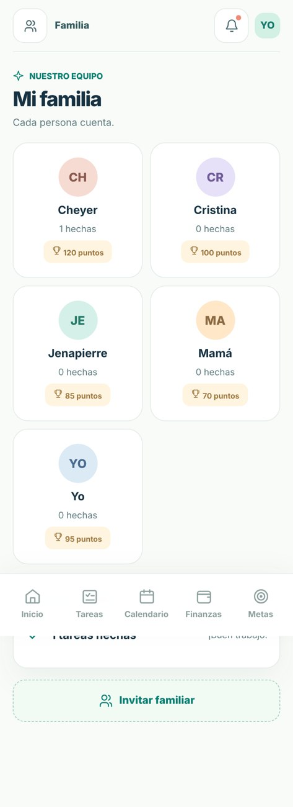
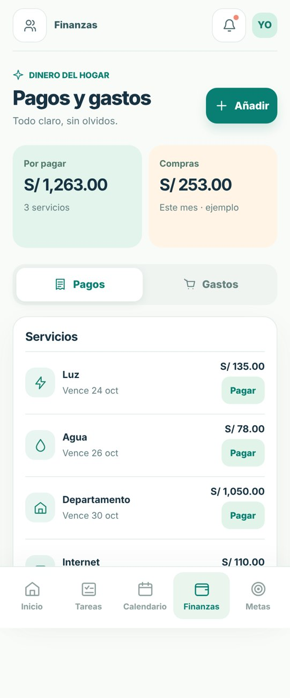
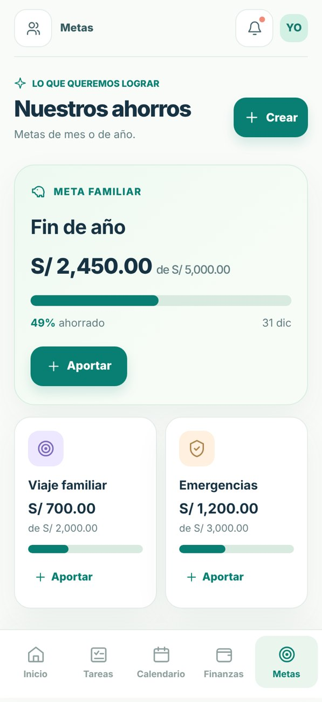
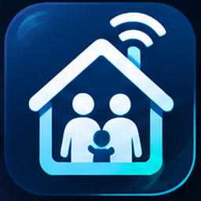

<div align="center">
  

  # CASA CONECTADA

  **Organiza las tareas, actividades, horarios, recordatorios, notas, objetivos y finanzas de tu hogar.**

  *Cada integrante participa. Toda la familia avanza.*

  <p>
    
    
    
    
    
    
  </p>

  [Visión](#-qué-es-casa-conectada) · [Módulos](#-módulos-del-hogar) · [Ejemplos](#-cómo-se-utilizará) · [Pantallas](#-experiencia-visual) · [Arquitectura](#-arquitectura) · [Estado](#-estado-real-del-proyecto)
</div>

---

## 🏡 ¿Qué es CASA CONECTADA?

**CASA CONECTADA** es una aplicación Android nativa para compartir y organizar las responsabilidades de una casa o departamento. Reúne en un mismo espacio a quienes conviven: qué tareas deben realizar, cuándo se hacen, quién es responsable, qué gastos vencen, qué metas persigue la familia y qué información conviene recordar.

Imagina un hogar donde se pueden programar actividades como **sacar al perro, lavar los platos, limpiar el baño, ordenar la sala, sacar la basura, hacer las compras, pagar la luz, el agua o internet**. Cada integrante podrá consultar sus pendientes, aportar evidencia cuando sea necesario y visualizar su progreso. Algunas de estas experiencias ya existen de forma local; otras forman parte de la hoja de ruta.

El diseño prioriza una interfaz **premium, intuitiva y visual**, con tarjetas, iconografía coherente, imágenes ilustrativas, porcentajes, barras de avance, puntos y futuras estadísticas, y una arquitectura **offline-first** que permitirá sincronizar únicamente cuando sea necesario.

> **Estado importante:** proyecto en desarrollo, no una aplicación de producción. La APK de depuración Premium V3 fue compilada e instalada en Android; el registro ADMIN, inicio de sesión, invitación y registro MEMBER fueron comprobados en una API **local**. La autenticación en Android y la sincronización remota entre celulares **todavía no funcionan**.

## ✨ Módulos del hogar

| Módulo | Qué permite o permitirá hacer | Estado comprobado |
|---|---|---|
| 🏠 **Inicio y resumen** | Consultar pendientes, pagos próximos, metas y progreso del hogar | Resúmenes locales y UI Premium V3 |
| ✅ **Tareas domésticas** | Asignar actividades con responsable, fecha, frecuencia y evidencia fotográfica; ganar puntos por cumplimiento | Registro y finalización local; repetición automática pendiente |
| 🐕 **Actividades compartidas** | Coordinar pasear mascotas, limpieza, compras, cocinar y otras responsabilidades compartidas | Representadas hoy como tareas; módulo específico pendiente |
| 📅 **Horarios y calendario** | Ver fechas de tareas y pagos; planificar turnos diarios, semanales o mensuales | Agenda cronológica local; horarios/turnos avanzados pendientes |
| 🔔 **Recordatorios y alertas** | Avisar antes de tareas, actividades, vencimientos y compromisos | Pendiente: notificaciones y programación |
| 📝 **Notas y listas** | Compartir notas del hogar, listas de compras, indicaciones y avisos para los integrantes | Pendiente |
| 💳 **Gastos y servicios** | Registrar compras, cuentas por pagar, vencimientos, comprobantes y gastos compartidos | Gastos/pagos locales; reparto y asignación múltiple pendientes |
| 🏦 **Bancos, Yape y Plin** | Gestionar medios de aporte y, posteriormente, cuentas personales con permisos | Métodos dentro de metas locales; cartera personal pendiente |
| 🎯 **Metas y objetivos** | Ahorrar para viajes o compras, registrar aportes y seguir avances; planificar futuros objetivos no financieros | Metas monetarias locales; objetivos generales pendientes |
| 🏆 **Logros y ranking** | Visualizar puntos, porcentajes de cumplimiento, barras, rachas y logros familiares | Puntos y progreso básico; insignias/ranking pendientes |
| 👨‍👩‍👧‍👦 **Familia y perfiles** | Fotos, datos personales, ADMIN y miembros con cuenta propia | Perfiles locales; ADMIN/MEMBER probados solo en API local |
| ☁️ **Sincronización bajo demanda** | Compartir cambios autorizados entre celulares al abrir, guardar o sincronizar manualmente | Base D1 y API local; sincronización Android ↔ nube pendiente |

### ¿Qué diferencia a cada módulo?

- **Tarea:** responsabilidad concreta asignada a alguien, como lavar los platos antes de las 20:00; puede requerir fotografía y otorgar puntos.
- **Actividad:** evento o compromiso compartido con horario, como sacar al perro dos veces al día o hacer compras el sábado.
- **Recordatorio:** aviso oportuno asociado a una tarea, actividad o pago, sin exigir conexión permanente a Cloudflare.
- **Nota:** información que la familia necesita consultar, como una lista de compras o indicaciones para el hogar.
- **Meta u objetivo:** resultado medible en el tiempo, por ejemplo ahorrar S/ 1,000 para un viaje o completar una meta de limpieza semanal.

Las definiciones anteriores describen el **alcance funcional previsto**; no implican que todas sus pantallas ya estén desarrolladas.

## 🧭 Cómo se utilizará

**Ejemplo de rutina de un departamento compartido** (escenario objetivo de producto, todavía no automatizado en su totalidad):

| Momento | Actividad | Responsable | Seguimiento previsto |
|---|---|---|---|
| 07:00 | Sacar al perro | Integrante A | Recordatorio y tarea diaria |
| 09:00 | Lavar los platos | Integrante B | Confirmación y puntos |
| 15:00 | Comprar productos del hogar | Integrante C | Lista compartida y gasto |
| 18:00 | Sacar la basura | Integrante A | Tarea rotativa |
| Día 25 | Pagar internet | Responsable asignado | Vencimiento, comprobante y reparto |
| Mensual | Ahorrar para una meta familiar | Familia | Aportes, porcentaje y barra de avance |

**La prioridad es la convivencia:** todos saben qué hacer, cuándo hacerlo y qué compromisos están pendientes. Las finanzas son un módulo más, no el propósito exclusivo de la aplicación.

## 📱 Experiencia visual

<div align="center">
  <strong>Conceptos visuales de referencia (no capturas de una versión publicada)</strong><br/><br/>
  
  
  
  
  
</div>

**Identidad visual:** jade, azul profundo, menta, marfil y coral. Componentes Jetpack Compose/Material 3, iconos consistentes, tarjetas con profundidad y gráficas fáciles de interpretar. Las imágenes 3D ilustran la dirección de diseño; las pantallas instaladas pueden diferir de los conceptos.

## 🧱 Arquitectura

```text
CASA CONECTADA/
├── app/                         # Kotlin Android, Jetpack Compose, MVVM
│   └── src/main/java/pe/casaconectada/
│       ├── presentation/        # Pantallas y ViewModel
│       ├── design/              # Material 3 y temas
│       ├── domain/              # Entidades y contratos
│       ├── data/                # Room/SQLite, repositorios, evidencias
│       ├── security/            # Protección local de datos sensibles
│       └── di/                  # Inyección de dependencias
├── backend/                     # Worker TypeScript en desarrollo
│   ├── src/                     # API HTTP, autenticación e invitaciones
│   ├── migrations/              # Versiones SQL para Cloudflare D1
│   └── test/                    # Pruebas
├── docs/
│   ├── branding/                # Logo, banner y referencias ilustradas
│   └── ALCANCE_FUNCIONAL.md     # Visión y criterios funcionales
└── .github/workflows/           # CI Android
```

El almacenamiento **Room/SQLite** mantiene la experiencia local. **Cloudflare Workers y D1** se han elegido para preparar la sincronización familiar *bajo demanda*, sin mantener servidores dedicados encendidos. El backend local no está desplegado públicamente.

### Stack

| Android | Backend | Herramientas |
|---|---|---|
| Kotlin, Jetpack Compose, Material 3 | TypeScript, Cloudflare Workers, D1 | Windows PowerShell, Git/GitHub |
| MVVM, Coroutines/StateFlow, Hilt | API REST, Wrangler | Gradle, Android SDK 35, JDK 17 |
| Room/SQLite, Coil, Android Keystore | Migraciones versionadas | GitHub Actions |

## 🚀 Desarrollo local con PowerShell

**APK Android** (JDK y SDK previamente instalados):

```powershell
cd "D:\CASA CONECTADA"
.\gradlew.bat assembleDebug

$adb = "$env:LOCALAPPDATA\Android\Sdk\platform-tools\adb.exe"
& $adb devices
& $adb install -r ".\app\build\outputs\apk\debug\app-debug.apk"
```

**API local** (Node 24, Wrangler 4):

```powershell
cd "D:\CASA CONECTADA\backend"
npm.cmd ci
npm.cmd exec tsc -- --noEmit
npm.cmd exec wrangler -- d1 migrations apply DB --local
npm.cmd exec wrangler -- dev --local --port 8787
```

Para hacer pruebas **por USB** desde un Android conectado:

```powershell
$adb = "$env:LOCALAPPDATA\Android\Sdk\platform-tools\adb.exe"
& $adb reverse tcp:8787 tcp:8787
& $adb reverse --list
```

El puerto invertido **solo prepara el acceso USB**; la APK aún no incorpora un cliente de autenticación conectado a esta API. `.dev.vars` es privado y **jamás** debe subirse al repositorio.

## ✅ Estado real del proyecto

**Verificado hasta el 15/10/2026:**

- [x] APK Premium V3 compilada e instalada en dispositivo Android real.
- [x] Room/SQLite y módulos locales de tareas, pagos, metas, calendario e integrantes.
- [x] Perfiles locales con foto y datos personales.
- [x] API Worker con D1 local, TypeScript verificado por `tsc --noEmit`.
- [x] Registro de ADMIN, inicio de sesión, invitación, registro MEMBER y listado familiar probados localmente.
- [x] `adb reverse tcp:8787 tcp:8787` verificado por USB.
- [ ] Autenticación Android conectada al backend; sesiones por dispositivo.
- [ ] Sincronización real entre celulares y control completo de permisos.
- [ ] Actividades con horarios y rotación automática de tareas.
- [ ] Recordatorios/notificaciones automáticas y notas compartidas.
- [ ] Cuentas bancarias privadas por usuario y división de gastos.
- [ ] Sistema completo de logros, objetivos no financieros y ranking.
- [ ] Endurecimiento de seguridad, respaldos, pruebas y despliegue público.

Documentación: [Alcance funcional](docs/ALCANCE_FUNCIONAL.md) · [Estado técnico](docs/ESTADO_DEL_PROYECTO.md) · [Seguridad](docs/SEGURIDAD_PUBLICACION.md).

## 🔒 Privacidad y límites

Repositorio público: **solo código y materiales de demostración**. No incluir correos, fotografías reales, contraseñas, tokens, `.dev.vars`, secretos, bases SQLite locales, claves de firma ni información financiera privada.

La autenticación funciona **solo en el backend local de desarrollo**. Antes de un despliegue con datos personales y bancarios deben completarse verificación y recuperación de cuentas, controles de acceso y autorización por recurso, prevención de abuso y pruebas de seguridad.

## 🗺️ Próximos hitos

1. **Cuentas individuales en Android:** sesión ADMIN y MEMBER, perfil propio e invitaciones.
2. **Agenda y organización:** actividades compartidas, turnos, horarios, recordatorios y notas.
3. **Finanzas familiares completas:** cuentas autorizadas, gastos distribuidos y comprobantes.
4. **Sincronización por cambios:** Room ↔ Workers/D1, con manejo offline y conflictos.
5. **Experiencia premium final:** estadísticas, barras, porcentajes, logros y gráficos.
6. **Calidad y publicación:** controles de seguridad, pruebas de integración, respaldos y versión firmada.

## 📄 Licencia

[MIT](LICENSE) · Proyecto de **CMCORPUSG**.

<div align="center">
  
  <p><strong>CASA CONECTADA</strong><br/>Tu hogar, un equipo.</p>
</div>
